<picture>
  <source media="(prefers-color-scheme: dark)" srcset="assets/header-dark.svg">
  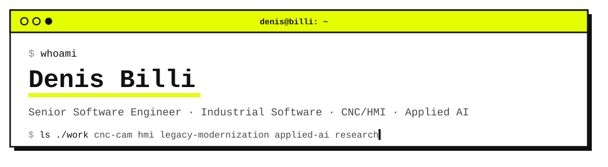
</picture>

  
  
  

I design and build software for complex industrial systems, with a strong focus on CNC machinery, HMI platforms, CAD/CAM workflows, legacy modernization and applied artificial intelligence.

My background is mainly in long-lived C++/C#/Python codebases, production software, machine-oriented logic, computational geometry, diagnostics, automation and human-machine interaction.

Most of my professional work happens inside private enterprise repositories and NDA-bound environments.  
This profile contains the public-facing subset of my engineering work, research experiments and independent projects.

---

## What I Work On

My work sits at the intersection of industrial software, machine automation and applied AI.

I am especially interested in systems that must remain understandable, maintainable and reliable over time: software that talks to machines, supports operators, assists engineering workflows and has to survive real production constraints.

Main areas:

- CNC and CAD/CAM software
- HMI design for industrial machinery
- Legacy C++/C# codebase modernization
- Multi-axis kinematics and machine-oriented computational geometry
- Internal tooling, QA automation and diagnostics
- Applied AI, ML and agent-based workflows for industrial use cases
- Research-oriented simulation and experimental software

---

## Featured Research

<table>
<tr>
<td width="33%" valign="top"><a href="https://github.com/denisbilli/ground-control-public">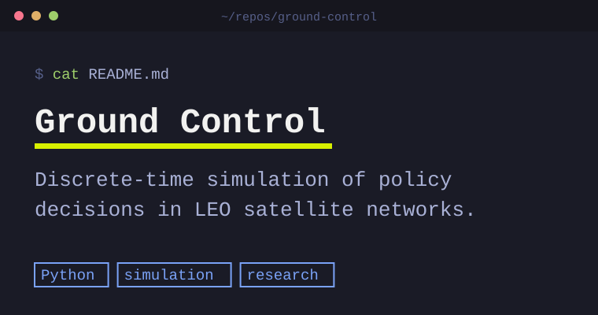</a> <b><a href="https://github.com/denisbilli/ground-control-public">Ground Control</a></b> LEO satellite networks, policy decisions, falsification-driven simulation</td>
<td width="33%" valign="top"><a href="https://github.com/denisbilli/spectral-generalization-paper">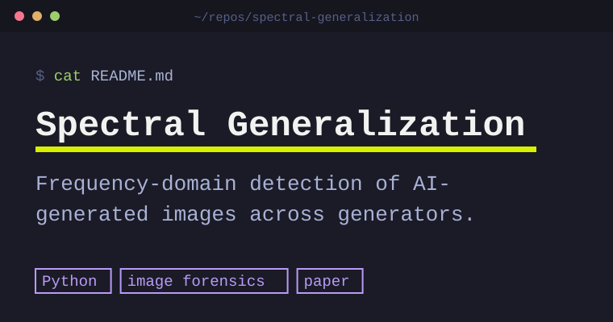</a> <b><a href="https://github.com/denisbilli/spectral-generalization-paper">Spectral Generalization</a></b> Frequency-domain detection of synthetic and AI-generated imagery</td>
<td width="33%" valign="top"><a href="https://github.com/denisbilli/storyhash-paper">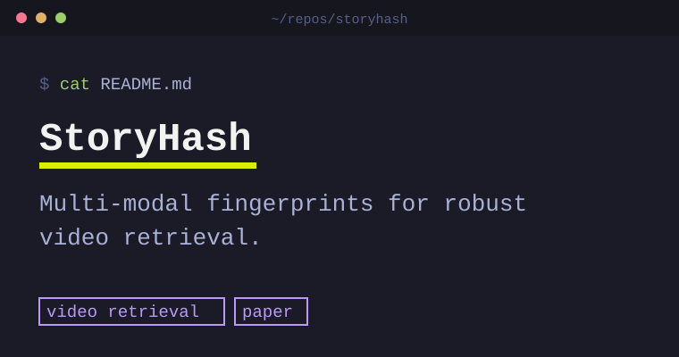</a> <b><a href="https://github.com/denisbilli/storyhash-paper">StoryHash</a></b> Multi-modal fingerprinting of video content for robust retrieval</td>
</tr>
</table>

<b>More on the research</b>

#### Ground Control

[Ground Control](https://github.com/denisbilli/ground-control-public) is a discrete-time simulation framework for studying policy decisions in LEO satellite network scenarios.

The project focuses on falsification-driven analysis rather than optimistic simulation: routing policies, DTN behavior, gateway placement, inter-satellite links, SLA trade-offs and topology constraints are tested through reproducible experiments.

Current public material includes:

- a simulation engine
- documented experiment batches
- OneWeb TLE-based validation through SGP4
- research notes and whitepaper material
- policy-level analysis for LEO constellation behavior

#### Spectral Generalization for Synthetic Image Detection

[Spectral Generalization](https://github.com/denisbilli/spectral-generalization-paper) explores frequency-domain methods for detecting synthetic and AI-generated imagery.

The project investigates whether spectral artifacts can generalize across generation models, datasets and image domains.

#### StoryHash

[StoryHash](https://github.com/denisbilli/storyhash-paper) is an experimental project about multi-modal fingerprinting of video content for robust video retrieval.

The goal is to represent video sequences through a single compact vector that fuses visual, temporal and structural signals, useful for similarity analysis, authenticity research and content-level comparison.

---

## Selected Public Projects

<table>
<tr>
<td width="33%" valign="top"><a href="https://github.com/denisbilli/paperdown">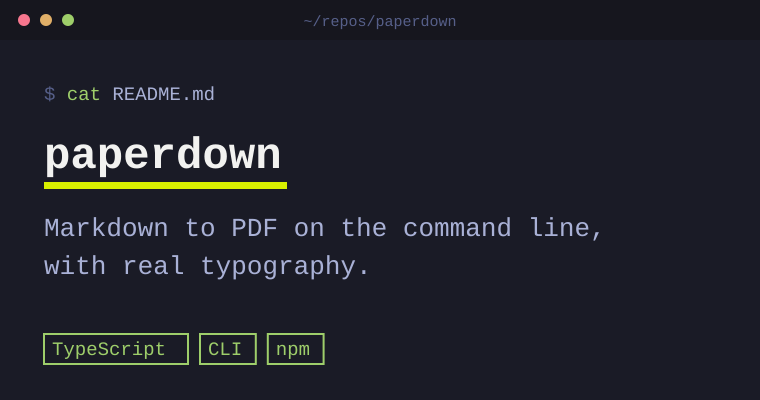</a> <b><a href="https://github.com/denisbilli/paperdown">paperdown</a></b> Markdown to PDF on the command line, with real typography instead of browser defaults.</td>
<td width="33%" valign="top"><a href="https://github.com/denisbilli/prodkit">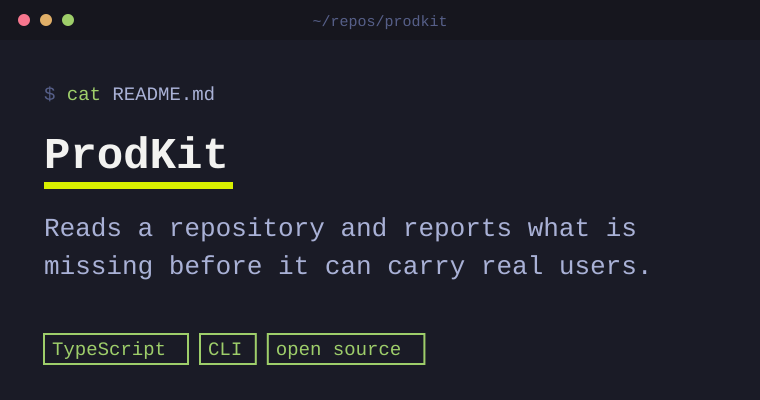</a> <b><a href="https://github.com/denisbilli/prodkit">ProdKit</a></b> An open-source command-line engine that reads a repository and reports what is missing before it can carry real users, judged as the kind of product it is meant to be.</td>
<td width="33%" valign="top"><a href="https://github.com/denisbilli/envlockup">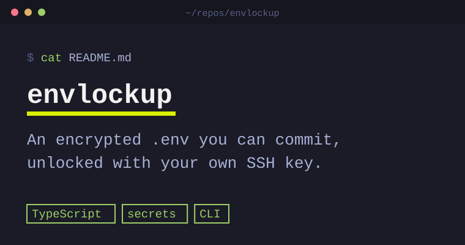</a> <b><a href="https://github.com/denisbilli/envlockup">envlockup</a></b> An encrypted .env you can commit: everyone decrypts it with their own SSH key, so people can be added or removed without sharing a secret.</td>
</tr>
<tr>
<td width="33%" valign="top"><a href="https://github.com/denisbilli/quested-platform">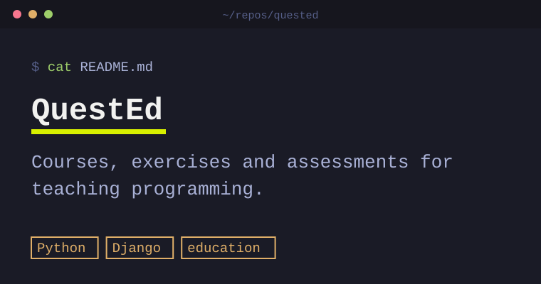</a> <b><a href="https://github.com/denisbilli/quested-platform">QuestEd</a></b> A platform for courses, exercises and assessments for teaching programming, built with Django.</td>
<td width="33%" valign="top"><a href="https://github.com/denisbilli/qDBManager">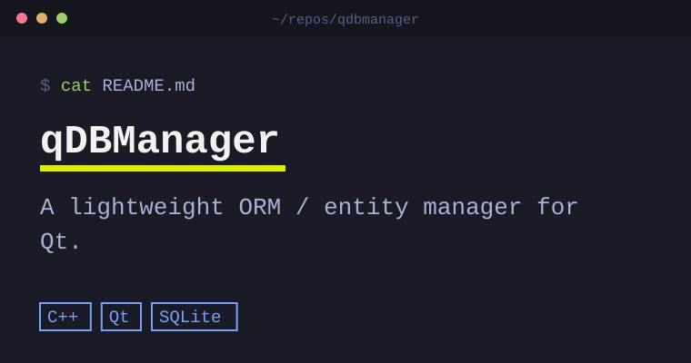</a> <b><a href="https://github.com/denisbilli/qDBManager">qDBManager</a></b> A lightweight ORM / entity manager for the Qt framework.</td>
<td width="33%" valign="top"><a href="https://github.com/denisbilli/PyImgDuplicateFinder">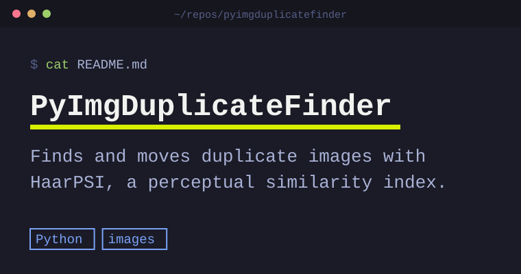</a> <b><a href="https://github.com/denisbilli/PyImgDuplicateFinder">PyImgDuplicateFinder</a></b> A Python utility to detect and move duplicate images using HaarPSI, a perceptual similarity index.</td>
</tr>
<tr>
<td width="33%" valign="top"><a href="https://github.com/denisbilli/Asteroids">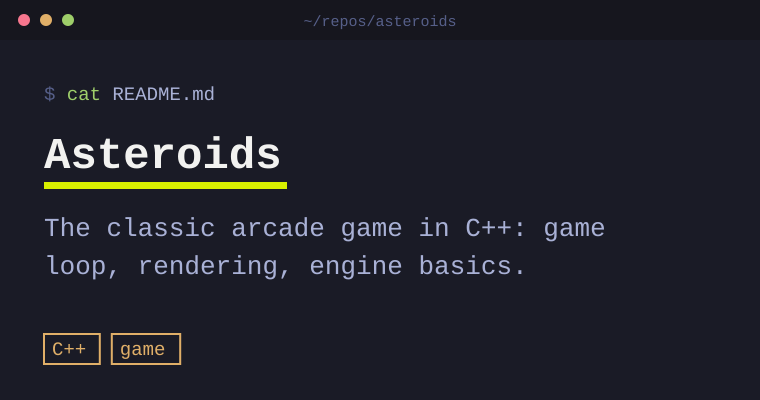</a> <b><a href="https://github.com/denisbilli/Asteroids">Asteroids</a></b> A C++ implementation of the classic arcade game, developed as an exploration of game loops, rendering and basic engine structure.</td>
<td width="33%" valign="top"></td>
<td width="33%" valign="top"></td>
</tr>
</table>

---

## Platforms and Side Projects

<table>
<tr>
<td width="50%" valign="top"><a href="https://snapbiz.app">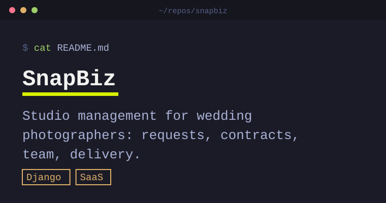</a> <b><a href="https://snapbiz.app">SnapBiz</a></b> Platform for managing photography businesses</td>
<td width="50%" valign="top"><a href="https://scribit.ai">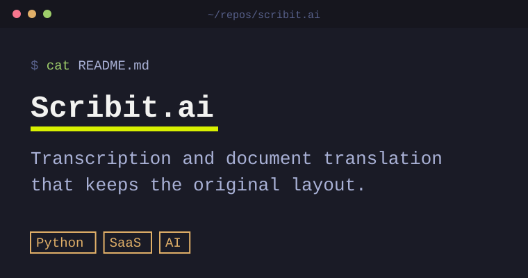</a> <b><a href="https://scribit.ai">Scribit.ai</a></b> Transcription and document translation</td>
</tr>
</table>

[SnapBiz](https://snapbiz.app) is a full-stack platform for managing photography businesses, including communication flows, client portals, reminders, contracts, internal collaboration and operational dashboards.

Built mainly with Django, Celery, REST APIs and automation-oriented backend workflows.  
It is progressively evolving toward a SaaS model with analytics and AI-assisted business workflows.

[Scribit.ai](https://scribit.ai) is a transcription and document translation platform: recordings become usable text, and Word and PDF files are translated keeping their original layout, with integrity and glossary checks.

#### CNC / CAM R&D Tools

Private tools and prototypes covering:

- 5-axis kinematics
- angle computation
- ISO code generation
- post-processing
- machine simulation
- validation utilities
- ML-based diagnostics and pattern analysis

---

## Writing & Knowledge Sharing

I write about AI, software engineering and the impact of emerging technologies on industrial work.

My focus is not hype, but what happens when AI enters real organizations: legacy systems, production constraints, human workflows, costs, safety, maintainability and decision-making.

I publish mainly on LinkedIn and on [Substack](https://denisbilli.substack.com), where I collect longer-form essays and research-oriented reflections.

I also mentor students and colleagues on Git workflows, computational geometry, machine learning, game development, CNC/HMI architecture and AI explainability.

### Latest writing

The essays are written in Italian.

<!-- redattore:scritti:inizio -->
- [Cosa direbbe di noi un contadino del 1750?](https://denisbilli.substack.com/p/cosa-direbbe-di-noi-un-contadino) · October 2026
- [“Nessuno mi uccide con l’inganno, non con la forza.”](https://denisbilli.substack.com/p/nessuno-mi-uccide-con-linganno-non) · September 2026
- [Ci vuole una città](https://denisbilli.substack.com/p/ci-vuole-una-citta) · August 2026
- [OpenAI, Hugging Face e l’IA che ha aggirato l’esame](https://denisbilli.substack.com/p/openai-hugging-face-e-lia-che-ha) · July 2026
- [Emma-5, l’IA italiana e il problema di quando il sogno arriva prima del prodotto](https://denisbilli.substack.com/p/emma-5-lia-italiana-e-il-problema) · June 2026
<!-- redattore:scritti:fine -->

---

## Engineering Philosophy

I tend to work on software where shortcuts become expensive.

My engineering approach is shaped by industrial constraints: hardware limits, safety, latency, cost, backward compatibility, maintainability and long product lifecycles.

I value:

- correctness before cleverness
- explainability over blind optimization
- measurable improvements over theoretical elegance
- simple tools until complexity is justified
- production behavior over demo behavior
- maintainability as a first-class design constraint

I am skeptical of black-box solutions when they are placed inside operational systems without evaluation, observability or failure boundaries.

---

## Tech Stack

        

`CAD/CAM` · `CNC` · `HMI` · `Industrial Automation` · `Machine Simulation` · `Applied AI` · `ML Prototyping` · `Agent Workflows` · `Software Architecture` · `Legacy Modernization`

---

## Patents and Industrial IP

I am inventor or co-inventor of multiple software patents related to CNC machinery, HMI workflows, CAD/CAM automation and machine-control logic.

Details are available only where disclosure is permitted.

---

## Why This Profile Exists

This profile is a public snapshot of a broader technical path: industrial software engineering, applied AI research, independent experimentation, teaching and product-oriented side projects.

The common thread is building software that has to deal with reality: machines, users, constraints, costs, failures and long-term maintenance.

For technical discussions, research collaboration or professional inquiries, feel free to reach out.
